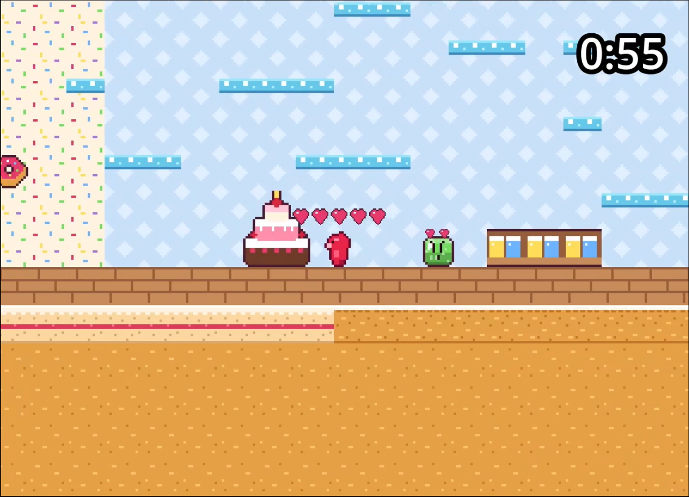
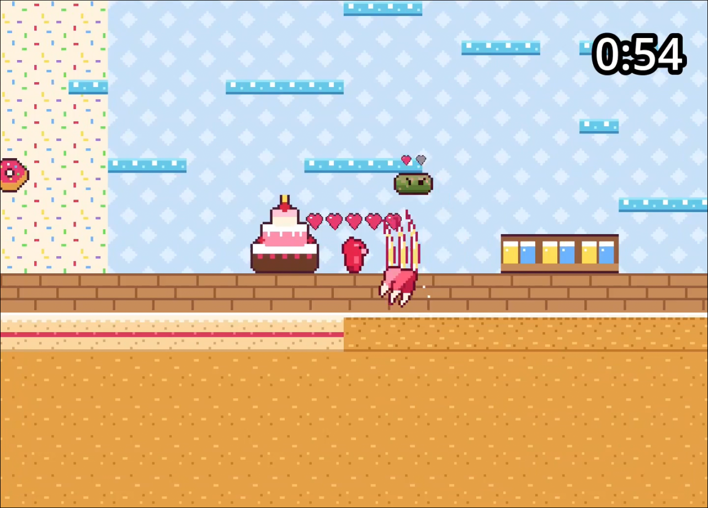

# Bear Candy Game

Atividade P2 da matéria 'Jogos Digitais 2'

## O jogo
O jogo consiste em uma loja de doces, onde o player entra em uma area, e monstros em forma de goma começam a pular na direção dele.
Tente sobreviver o tempo necessário para vencer.

## Carta
- Tema: loja de doces
- Tipo de jogo: 2D
- Modo: plataforma

## Como jogar
- Mover: A / D ou setas esquerda / direita
- Pular: Espaço
- Atacar: Clique esquerdo do mouse na direção OU teclas J e K para atacar para esquerda e direita. Pressionar para cima (W) ou para baixo (S) e atacar faz com que ataque acima/abaixo do player

## Captura de tela

## Créditos
- Arte: gerada por IA (Claude, da Anthropic), criada para este projeto.
